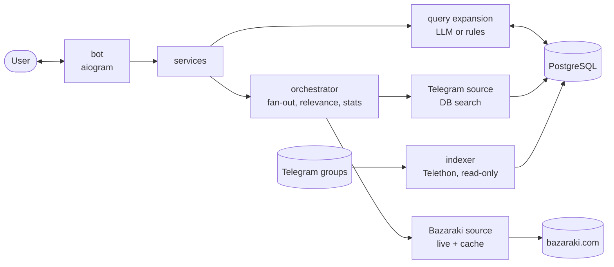

# TrevorTheHelper

A Telegram bot for second-hand shopping in Cyprus. Send it a product name ("iphone 13 128gb",
"велосипед горный 26") and it replies with the active listings from Bazaraki and from Telegram
groups you choose, plus average, median, min and max price in EUR and the best deals. It saves you
from checking each site and group by hand and tells you whether a price is good. English and Russian.

> **Bazaraki's terms of use forbid bots and scrapers** (<https://www.bazaraki.com/about/rules/>,
> 4.1 and 5.3.1(f)), even though robots.txt allows `/search/`. This project fetches Bazaraki anyway,
> for **private, low-volume use only**. Don't run it as a public service. To skip Bazaraki, set
> `ENABLED_SOURCES=telegram`. More in [Limitations](#limitations).

## Prerequisites

- Docker with Docker Compose. Without Docker: Python 3.12+ and PostgreSQL 16 (with `pg_trgm`).
- A bot token from [@BotFather](https://t.me/BotFather): send `/newbot`, copy the token.
- For Telegram groups only: `api_id` and `api_hash` from <https://my.telegram.org> (API development
  tools), and a **separate Telegram account** that is a member of each group. The indexer only
  reads; it never sends, edits or joins anything.
- Optional: an Anthropic API key for better query expansion. Without one, a rule-based fallback is used.
- Your numeric Telegram id (ask [@userinfobot](https://t.me/userinfobot)).

## Quickstart

```bash
git clone https://github.com/NopPer-zofix/TrevorTheHelper.git
cd TrevorTheHelper
cp .env.example .env          # PowerShell: Copy-Item .env.example .env
```

Edit `.env`:

```dotenv
BOT_TOKEN=123456:ABC...
ALLOWED_USER_IDS=111111111                     # empty means anyone can use the bot
TELEGRAM_API_ID=1234567                        # only for Telegram groups
TELEGRAM_API_HASH=0123456789abcdef0123456789abcdef
TELEGRAM_GROUPS=baraholka_kipr,https://t.me/another_group
```

Log the reader account in once. It asks for the phone number, code and 2FA password, and saves
a session to `./data/`:

```bash
python -m venv .venv && .venv/bin/pip install -e .      # Windows: .venv\Scripts\pip
.venv/bin/python -m aggregator.sources.telegram.login   # same as: make telegram-login
```

Start it:

```bash
docker compose up --build       # same as: make up
```

This runs `postgres`, a one-shot `migrate`, `bot` and `indexer`. Open your bot in Telegram,
send `/start`, pick a language and city, then send a product name.

Bazaraki only (no reader account)? Set `ENABLED_SOURCES=bazaraki` and run
`docker compose up --build bot`; otherwise the indexer container exits for lack of a session.

Without Docker: `pip install -e .`, `alembic upgrade head`, then `aggregator-bot` and
`aggregator-indexer` in two terminals. Give them different `HEALTH_PORT` values (default 8080).

## Configuration

Set in `.env`; every option is in `src/aggregator/config.py`. The important ones:

| Variable | Default | Meaning |
|---|---|---|
| `BOT_TOKEN` | – | Token from BotFather. Required. |
| `ALLOWED_USER_IDS` | empty | Comma-separated user ids allowed to use the bot. Empty = public. |
| `TELEGRAM_API_ID`, `TELEGRAM_API_HASH` | – | Reader account credentials. |
| `TELEGRAM_GROUPS` | empty | Groups to index: usernames or `t.me` links. |
| `TELEGRAM_BACKFILL_DAYS` | `30` | History loaded when the indexer starts. |
| `ANTHROPIC_API_KEY` | empty | Turns on LLM query expansion. |
| `ANTHROPIC_MODEL` | `claude-haiku-5-5` | Model for query expansion. |
| `DATABASE_URL` | local Postgres | Compose points it at the `postgres` container. |
| `ENABLED_SOURCES` | `bazaraki,telegram` | Sources to query. |
| `BAZARAKI_CACHE_TTL_SECONDS` | `300` | Reuse a Bazaraki result for the same query and city. |
| `LISTING_MAX_AGE_DAYS` | `30` | Older Telegram listings are hidden. |
| `BEST_DEAL_RATIO` | `0.75` | A best deal costs at most this share of the median. |
| `RELEVANCE_MIN_SCORE` | `0.75` | Weaker matches (0 to 1) are dropped. |
| `RATE_LIMIT_ENABLED` | `false` | Per-user limit, 5 searches per 60 s by default. |

## How it works



`bot` and `indexer` are separate processes that share only the database. A search expands your
text into English and Russian variants, queries all sources in parallel with a timeout each
(a failing source is reported, the rest still answer), drops irrelevant listings, and computes stats
with outliers removed. Stats are flagged unreliable under 3 priced listings; best deals need 5.

## Project structure

```text
src/aggregator/
  config.py       settings
  domain/         Listing, Filters, cities, currency, price parsing
  sources/        ListingSource interface, registry, and one package per source
                  (bazaraki/, telegram/, facebook/ stub)
  query/          query expansion: LLM, rule-based fallback, cache
  search/         orchestrator, relevance filter, filters and sorting
  analytics/      price stats, outliers, best deals
  services/       what the bot calls: users, search, sessions, rate limit, quota
  bot/            handlers, keyboards, formatting, i18n (en/ru)
  db/             models, repositories, Alembic migrations
tests/            pytest, no live network calls
docs/             spec, progress notes, Bazaraki research
```

## Development

```bash
pip install -e ".[dev]"
ruff check . && ruff format --check . && mypy && pytest     # same as: make check
```

Tests marked as DB tests are skipped unless `TEST_DATABASE_URL` is set. **They drop all tables in
that database**, so use a throwaway one. CI sets this up with a Postgres container.

### Adding a source

1. Write a class with a `name` and `async def search(query, city, filters) -> list[Listing]`
   (the `ListingSource` protocol in `sources/base.py`). Raise `SourceError` on failure.
2. Add a branch for it in `build_registry()` in `sources/registry.py`.
3. Add the name to `ENABLED_SOURCES` and a label to `SOURCE_LABELS` in `bot/formatting.py`.
4. Test the parser with saved fixtures (see `tests/test_bazaraki_parser.py`).

The orchestrator, filters, stats and bot need no changes.

## Limitations

- **Legal.** Besides the Bazaraki terms above: the client only requests `/search/` HTML, never the
  disallowed `/api` or `attrs_*` URLs. It waits at least 1 s between requests, caches results,
  identifies itself honestly, and does not retry or work around a 403 or CAPTCHA. Telegram messages
  are stored in your own database; Telegram's terms and each group's rules still apply.
- **Not yet run end to end.** Tests use fakes and saved fixtures. A full run against real
  Telegram, Bazaraki, Postgres and the Anthropic API hasn't been done yet, so expect small fixes.
- **Bazaraki dates are approximate** (the site only shows "3 days ago"), shown as `~dd.mm.yyyy`.
  If Bazaraki changes its page markup, the source reports itself unavailable.
- **Relevance is heuristic.** "iPhone 13 Pro Max" can match "iphone 13". A multi-item post yields
  its first price only; a price without a currency is read as EUR.
- **Filters.** Price filters are euros only and hide listings without a price. Results live in
  memory for an hour and are lost on restart. Old result messages act on your latest search.
- **Telegram city detection** uses a lookup table; posts without a city show as "unknown" and
  appear under "All Cyprus" only.
- **Polling only.** Webhook mode is a stub in `bot/runner.py`.

### Facebook Marketplace

Not implemented. There is no public API, listings need a logged-in account, and automated access
breaks Meta's terms and gets accounts banned. `FacebookMarketplaceSource` is a stub that raises
`NotImplementedError` behind `ENABLE_FACEBOOK_MARKETPLACE`. Things worth trying: an official
data partnership, a user-supplied export or shared links, or a browser extension that only reads
pages the user is already viewing. Bypassing the login wall or bot detection is out of the question.

## Roadmap

- Facebook Marketplace source
- Saved searches and alerts
- Cross-platform duplicate detection
- User plans and payments (`users.plan` and `check_quota()` are the hooks, currently always allow)
- Redis cache, webhook mode, task queue
